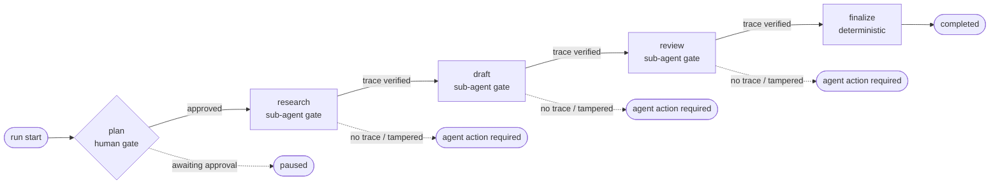
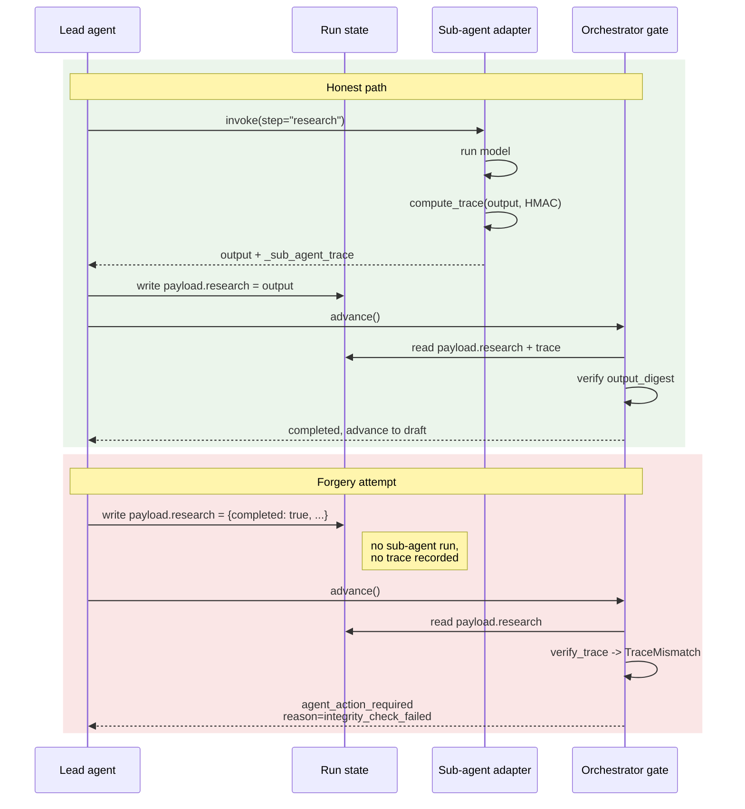

# agents-orchestrator

[](https://github.com/AlinaTsvetkova/agents-orchestrator/actions/workflows/tests.yml)
[](LICENSE)

A small reference implementation of a multi-agent workflow orchestrator with
**cryptographic sub-agent verification**: the lead agent cannot forge the work
of sub-agents by editing state files, because every sub-agent output is
committed to by an invocation trace that the orchestrator verifies at each
gate.

The code is intentionally compact — ~900 lines of Python, standard library plus
`jsonschema`, Python 3.11+. It runs end-to-end against a deterministic mock
agent, so you can clone, run, and inspect the full state machine in under a
minute with no API keys.

## The idea in one paragraph

Multi-agent systems typically coordinate a *lead agent* with one or more
*sub-agents*. The lead agent decides what to do next and reads the sub-agents'
outputs out of a shared state file. In every such system I've seen, nothing
prevents the lead agent from writing a plausible-looking sub-agent output
directly into state and advancing as if the sub-agent had run. If sub-agents
are meant to be an *independent verification layer* (reviewer, auditor,
critic), that silent-forgery path breaks the entire trust model. This repo
closes that gap: sub-agent adapters commit to their outputs with HMAC-signed
invocation traces, and the orchestrator refuses to accept a step as complete
unless the trace verifies against the current state payload.

## How it works

### Workflow state machine

Five sequential steps. Each step's gate decides whether the orchestrator
advances, asks the operator to intervene, or asks for a sub-agent run.



### Trust boundary in a single gate

Honest path on top, forgery attempt on the bottom. The gate rejects a
state that was not produced by a traced sub-agent invocation.



## Quickstart

```bash
git clone <repo>
cd agents-orchestrator
python3 -m venv .venv && source .venv/bin/activate
pip install -e .

# Run the whole workflow against the mock agent, auto-approving the plan gate.
orchestrator run --auto-plan "write a short note on HMAC vs plain hashing"

# Inspect the resulting run state.
orchestrator inspect <run-id>
```

Without `--auto-plan`, the run pauses at the plan gate waiting for human
approval. Resume with:

```bash
orchestrator resume --approve-plan <run-id>
```

Inspect a run's current state:

```bash
orchestrator inspect <run-id>
# Run:       <uuid>
# Task:      write a short note on HMAC vs plain hashing
# Status:    completed  (workflow_status=completed)
# Progress:  5/5 steps completed (plan, research, draft, review, finalize)
# Traces:    3 verified (draft, research, review)
# Overrides: 0
# Warnings:  0

orchestrator inspect <run-id> --json    # full state as JSON
```

## Using with real agents

The default `mock` adapter is offline and deterministic; use it for tests,
demos, and development. For real inference, select a CLI adapter:

```bash
# Anthropic Claude Code (requires `claude` binary and ANTHROPIC_API_KEY)
orchestrator run --adapter claude --auto-plan "<task>"

# OpenAI Codex CLI (requires `codex` binary and OPENAI_API_KEY)
orchestrator run --adapter codex --auto-plan "<task>"
```

The two providers enforce output structure differently:

- **Codex** supports `--output-schema <path>`; the adapter materialises the
  per-step JSON schema into a temp file and lets the CLI constrain the
  model's response at the API boundary. This is **hard** enforcement.
- **Claude Code** has no direct equivalent, so the adapter relies on the
  prompt contract (`_STEP_CONTRACTS`) only. This is **soft** enforcement —
  the adapter raises `CLIAdapterError` if the returned JSON doesn't parse,
  but the model could in principle return extra fields that still parse.

In production, set `ORCHESTRATOR_TRACE_SECRET` in the adapter's environment
so traces are HMAC-signed. The secret must not be readable by the lead-agent
process; otherwise the integrity layer degrades from tamper-proof to
tamper-evident.

## Human overrides

When a sub-agent is unavailable (API outage, upstream degradation), an
operator can take manual ownership of a gate:

```bash
orchestrator override <run-id> research \
    --reason "ran the research step manually against incident-472" \
    --operator alice
orchestrator resume <run-id>
```

The override is recorded on both the step payload and an append-only
`payload.overrides` audit list, so a later edit cannot erase the fact it
happened. Reason strings shorter than 12 non-whitespace characters are
rejected — a weak but effective guard against lazy `"ok"` overrides.

## What the state machine does

Five steps, three sub-agent gates, one human gate:

| Step       | Gate type    | Who satisfies it            |
|------------|--------------|-----------------------------|
| `plan`     | human        | operator approves           |
| `research` | sub-agent    | sub-agent + verified trace  |
| `draft`    | sub-agent    | sub-agent + verified trace  |
| `review`   | sub-agent    | sub-agent + verified trace  |
| `finalize` | deterministic| framework composes artifact |

Runs are persisted as JSON under `runs/<run-id>.json`. Any interrupted run can
be resumed from its persisted state.

## Trust model

Sub-agent gates (`research`, `draft`, `review`) are the forgery-sensitive
ones. For each, the orchestrator requires:

1. an invocation trace in `payload.sub_agent_traces[step]` matching the
   `output_digest` recomputed from the current step payload, **or**
2. a `payload.<step>.human_override_reason` string explaining why an operator
   is taking manual ownership of the gate.

Traces are HMAC-SHA256 when `ORCHESTRATOR_TRACE_SECRET` is set in the
adapter's environment (true forgery protection), and plain SHA-256 otherwise
(tamper-evident, not tamper-proof). The secret should live wherever the
adapter runs and should not be readable by the lead agent process.

See [docs/DESIGN.md](docs/DESIGN.md) for the full design rationale —
why two digests, why `extract_traceable_output`, why verify must run before
framework-side mutations of the payload.

## Environment

| Variable                        | Default | Meaning                                                                 |
|---------------------------------|---------|-------------------------------------------------------------------------|
| `ORCHESTRATOR_TRACE_SECRET`     | unset   | When set, traces are HMAC-signed with this secret.                      |
| `ORCHESTRATOR_STRICT_INTEGRITY` | `1`     | `0` downgrades trace mismatches to warnings (for migrating legacy runs).|
| `ORCHESTRATOR_LOG_LEVEL`        | `INFO`  | `DEBUG` / `INFO` / `WARNING` / `ERROR`.                                 |
| `ORCHESTRATOR_LOG_FORMAT`       | `json`  | `json` or `text`.                                                       |

## Logging

Every state transition, handoff decision, integrity check, and agent
invocation emits a structured JSON record to stderr, keyed by `run_id`. Grep
one `run_id` to reconstruct the full decision trail of a run.

## Testing

```bash
python -m unittest discover -s tests
```

29 tests cover: trace creation and verification (tampered output, step
mismatch, HMAC with wrong secret, human override), the five-step state
machine, soft-mode warnings, CLI end-to-end runs, and run-state schema
validation.

## Status

Reference implementation. The orchestration and verification primitives are
deliberately thin — the goal is to be a clear argument for a trust-boundary
pattern that production multi-agent frameworks could adopt, not a production
workflow engine.

## License

MIT. See [LICENSE](LICENSE).
